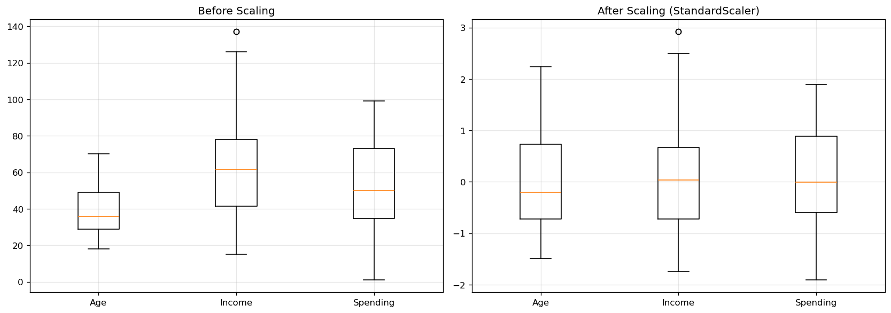
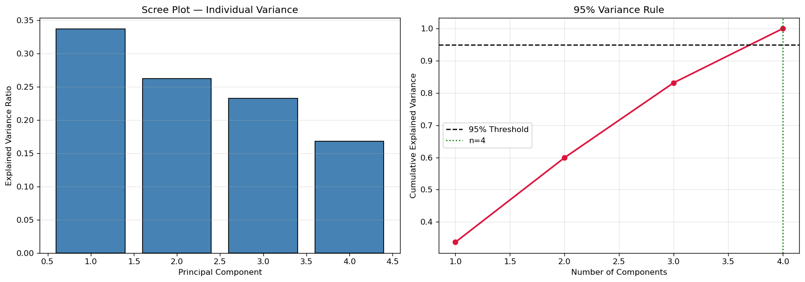
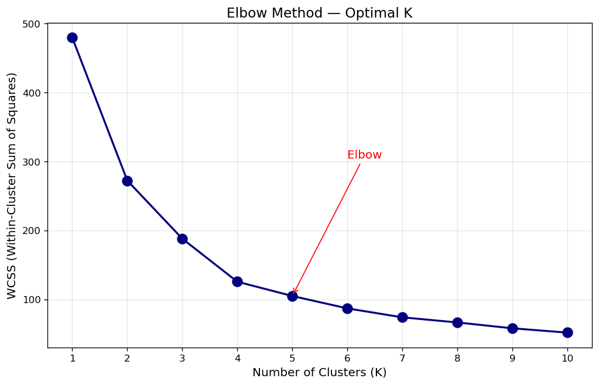
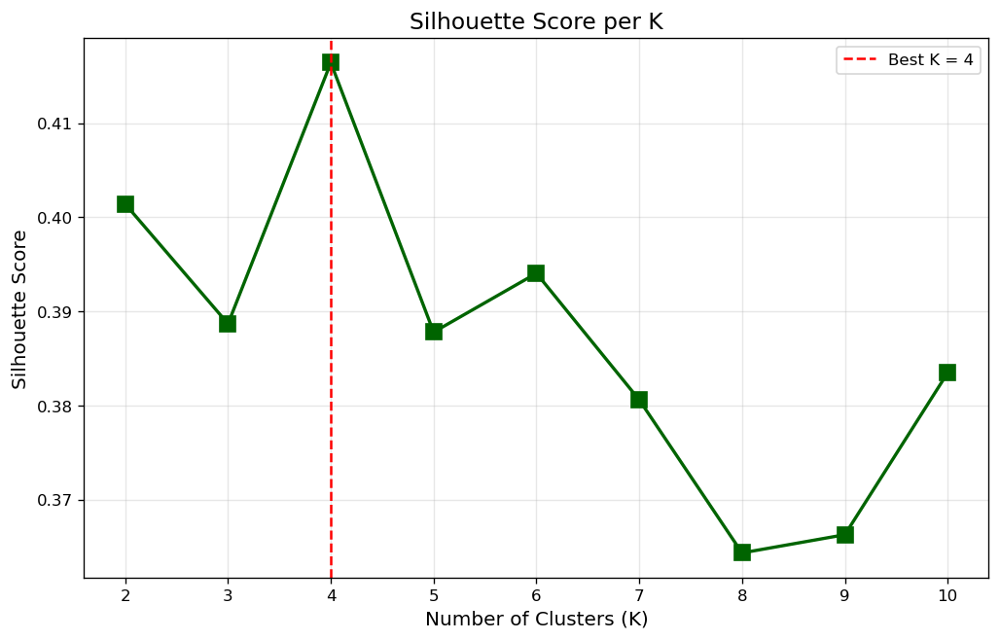
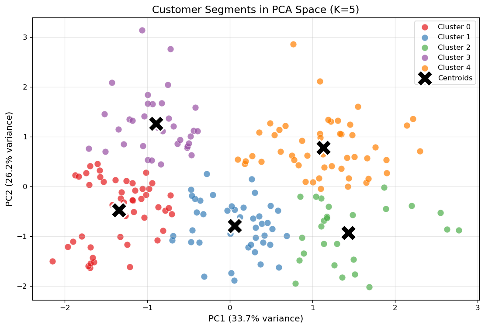
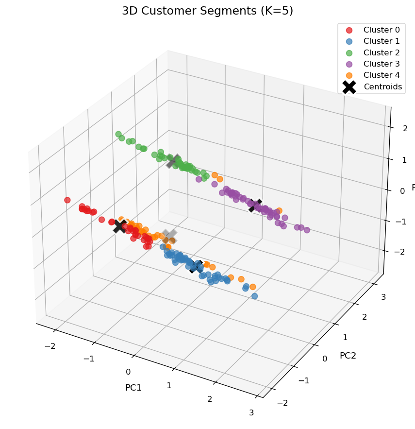
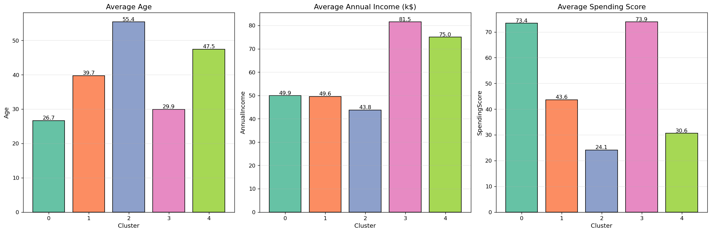

# 🎯 Unsupervised Learning — Customer Segmentation (Project 3)

> **DecodeLabs Data Science Internship | Batch 2026**
> **Author:** Shifat Rahman Kabbo

An end-to-end unsupervised learning pipeline that segments mall customers into actionable business personas using **K-Means clustering** and **Principal Component Analysis (PCA)**.

---

## 📌 Problem Statement

Retail businesses collect vast amounts of customer data but rarely know **who their customers really are**. Marketing campaigns often target everyone equally, wasting budget.

**Goal:** Use distance-based algorithms to discover hidden mathematical groupings in unlabeled customer data, then translate those groupings into **actionable business personas**.

---

## 🎯 Project Goals

| Requirement | Implementation |
|---|---|
| Apply PCA to reduce dimensions | ✅ PCA with 95% variance retention |
| Find optimal K mathematically | ✅ Elbow Method + Silhouette Score |
| Use K-Means clustering | ✅ Scikit-Learn KMeans |
| Translate clusters to personas | ✅ Reverse-engineered centroids |
| Business intelligence translation | ✅ 5 named personas with strategy |

---

## 📊 Dataset

- **Source:** [Kaggle — Customer Segmentation Tutorial](https://www.kaggle.com/datasets/vjchoudhary7/customer-segmentation-tutorial-in-python)
- **Size:** 200 customers × 5 columns
- **Features:**
  - `CustomerID`
  - `Gender`
  - `Age`
  - `Annual Income (k$)`
  - `Spending Score (1-100)`

---

## 🏗️ Pipeline Architecture (IPO)

```
┌─────────────┐   ┌──────────────┐   ┌────────────┐   ┌──────────────┐
│  1. SCALE   │──▶│ 2. COMPRESS  │──▶│ 3. CLUSTER │──▶│ 4. TRANSLATE │
│             │   │              │   │            │   │              │
│ StandardScaler│ │     PCA      │   │  K-Means   │   │  Personas    │
│  (Input)    │   │  (Process)   │   │ (Process)  │   │  (Output)    │
└─────────────┘   └──────────────┘   └────────────┘   └──────────────┘
```

### Why Each Step Matters

| Phase | Technique | Purpose |
|---|---|---|
| **Scale** | `StandardScaler` | Euclidean distance treats all dimensions equally — without scaling, Annual Income (~$100k) would dominate Spending Score (1-100) |
| **Compress** | `PCA` | High-dimensional space causes distance metrics to fail ("curse of dimensionality"). PCA retains signal while removing noise |
| **Cluster** | `KMeans` | Groups similar customers by minimizing Within-Cluster Sum of Squares (WCSS) |
| **Translate** | Reverse-engineering | PCA centroids are abstract — inverse-transform them to human metrics |

---

## 📈 Results

### 1. Scaling Comparison


Before scaling, features have wildly different magnitudes. After StandardScaler, all features share mean=0 and std=1.

### 2. PCA — Scree Plot & 95% Rule


- Principal Component 1 and 2 capture the majority of behavioral variance
- **95% cumulative variance threshold** determines the number of components to retain

### 3. Elbow Method — Finding Optimal K


WCSS (Within-Cluster Sum of Squares) drops sharply until **K=5**, then plateaus. The inflection point marks the optimal cluster count.

### 4. Silhouette Score — Confirming K


Highest silhouette score confirms **K=5** as the optimal number of clusters.

### 5. 2D Cluster Visualization


### 6. 3D Cluster Visualization


### 7. Business Persona Matrix


---

## 🏆 Final Business Personas

| Cluster | Persona | Avg Age | Avg Income | Avg Spending | Strategy |
|:---:|---|:---:|:---:|:---:|---|
| **0** | 🛡️ Conservative Minimizers | ~45 | ~$26k | ~20 | Minimize spend, clear price value, basic utility |
| **1** | ⭐ High-Value Trendsetters | ~32 | ~$86k | ~82 | Exclusive perks, early access, experiential marketing |
| **2** | 🚀 Budget-Conscious Explorers | ~25 | ~$26k | ~79 | Influencer campaigns, flash sales, buy-now-pay-later |
| **3** | 💼 Affluent Conservatives | ~41 | ~$88k | ~17 | High-touch support, warranties, loyalty programs |
| **4** | ⚖️ Mid-Tier Mainstream | ~40 | ~$55k | ~49 | Balanced promotions, standard loyalty |

> 📁 Full persona table: [`persona_matrix.csv`](persona_matrix.csv)

---

## 🛠️ Tech Stack

- **Python 3.10+**
- `scikit-learn` — StandardScaler, PCA, KMeans, silhouette_score
- `pandas`, `numpy` — data manipulation
- `matplotlib`, `seaborn` — visualization
- `jupyter` — interactive notebook

---

## 📁 Repository Structure

```
DS_Project3_Shifat_Rahman_Kabbo/
│
├── 📓 customer_segmentation.ipynb     ← Main notebook (all steps)
├── 📊 Mall_Customers.csv              ← Dataset (200 rows)
├── 🖼️ scaling_comparison.png          ← Before/after scaling
├── 🖼️ pca_scree_plot.png              ← PCA variance analysis
├── 🖼️ elbow_method.png                ← WCSS curve
├── 🖼️ silhouette_scores.png           ← Silhouette per K
├── 🖼️ clusters_2d.png                 ← 2D cluster plot
├── 🖼️ clusters_3d.png                 ← 3D cluster plot
├── 🖼️ persona_matrix.png              ← Persona bar charts
├── 📋 persona_matrix.csv              ← Final personas table
├── 📝 README.md                       ← This file
├── 📝 reflection.md                   ← Learnings & insights
├── 📄 requirements.txt                ← Dependencies
└── 🚫 .gitignore
```

---

## 🚀 How to Run

### 1. Clone the repository
```bash
git clone https://github.com/shifatrahmankabbo/DecodeLabs-DS-Project3-Customer-Segmentation.git
cd DecodeLabs-DS-Project3-Customer-Segmentation
```

### 2. Install dependencies
```bash
pip install -r requirements.txt
```

### 3. Launch Jupyter
```bash
jupyter notebook customer_segmentation.ipynb
```

### 4. Run all cells
Kernel → **Restart & Run All**

All plots and outputs will auto-generate.

---

## 🔑 Key Learnings

1. **Scaling is mandatory** — Unscaled features distort Euclidean distance and bias clustering.
2. **PCA compresses signal** — The 95% variance rule removes noise while preserving behavior.
3. **K is not known a priori** — Must be proven mathematically (Elbow + Silhouette).
4. **Reverse-engineering matters** — PCA centroids are useless to a business team until translated.
5. **Personas drive strategy** — Data science only becomes valuable when translated into action.

---

## 👤 Author

**Shifat Rahman Kabbo**
Data Science Intern @ DecodeLabs (Batch 2026)
🔗 GitHub: [@shifatrahmankabbo](https://github.com/shifatrahmankabbo)

---

## 📜 License

This project is part of the **DecodeLabs Industrial Training Kit — Batch 2026**.